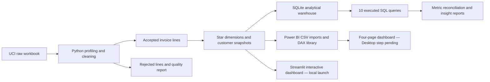

# Customer Revenue, Retention & Growth Analytics

**Python · SQL (SQLite execution / PostgreSQL-compatible queries) · Streamlit dashboard · Power BI preparation · DAX · data quality**

An end-to-end, reproducible analytics project built around actual retail-style business questions, not a predictive model looking for a use case. It turns historical invoice lines into a traceable sales warehouse, checks key calculations in both Python and SQL, and prepares seven import-ready tables for a four-page Power BI dashboard.

**Project status (October 2026):** The Python/SQL implementation, synthetic demo run, 39 automated tests, 10 SQL analyses, Streamlit dashboard source, report generator and Power BI handoff files are implemented. The **official UCI workbook could not be downloaded in the build environment**; **no UCI aggregate results, `.pbix`, deployed PostgreSQL database or genuine Power BI screenshots are claimed**. Run on the original workbook and finish Power BI Desktop before describing the full real-data portfolio project as complete. See [`reports/implementation_checklist.md`](reports/implementation_checklist.md).

## Interactive dashboard — RetailLens (Streamlit)

A **seven-view, local Streamlit dashboard** is provided in [`streamlit_app.py`](streamlit_app.py). It displays the bundled synthetic demo immediately after you install dependencies:

```bash
python -m streamlit run streamlit_app.py
```

The app opens in a browser, normally at `http://localhost:8501`. Use the sidebar to filter countries and transaction months, then explore executive KPIs, products, RFM/customer cohorts, recommendations, and the actual SQL/data-quality audit. It reads this project's generated CSVs and JSON reports; it is not a hosted website or substitute for Power BI Desktop. All seven page functions and interactive chart construction are smoke-tested with a simulated Streamlit interface, but **the real Streamlit browser UI itself has not been run in this offline build environment**.

**Full Windows commands, real-data switch and troubleshooting:** [`STREAMLIT_DEMO.md`](STREAMLIT_DEMO.md).

**Ready to publish?** See [GitHub → Streamlit Cloud deployment instructions](DEPLOY_STREAMLIT_CLOUD.md) and the verification boundaries described there.

## Business problem

A retailer has invoice-level transactions but no clear, consistent view of revenue, credit activity, customer retention or concentrated revenue sources. Management needs a repeatable definition of each KPI and a way to check that its BI numbers agree with the underlying transactions.

This project asks:

- How do gross sales, credits, net line sales, purchase volume and known customer activity change over time?
- Which individual products, countries and known customers contribute most to net line sales?
- How many identified customers return for another valid purchase?
- What does full-month cohort retention look like and which snapshot RFM segments need investigation?
- Where do returns and ambiguous source records create risk for analysis?
- Which experiments could test a recommendation without inventing uplift?

## One-screen architecture



Core path: source acquisition → profiling → audited cleaning → KPI definitions → star model → SQL queries → Python/SQL reconciliation → historical insights → Power BI → management questions.

## Dataset and provenance

Official source: [UCI Machine Learning Repository, Online Retail (dataset 352)](https://archive.ics.uci.edu/dataset/352/online+retail), [DOI 10.24432/C5BW33](https://doi.org/10.24432/C5BW33). Publisher/author: **Daqing Chen / UCI**; source dataset license: [CC BY 4.0](https://creativecommons.org/licenses/by/4.0/). UCI describes **541,909 original invoice lines, eight fields, December 1, 2010–December 9, 2011** for a UK non-store gift retailer. Source prices are in pound sterling (GBP).

| Original column | Meaning |
|---|---|
| InvoiceNo | Invoice identifier; a leading `C` denotes cancellation per source |
| StockCode | Item code |
| Description | Item description |
| Quantity | Signed item quantity (negative can mean credit) |
| InvoiceDate | Invoice time |
| UnitPrice | Pound-sterling unit price |
| CustomerID | Customer identifier, sometimes missing in the actual data |
| Country | Customer country |

**Absent data:** product costs, margins, discount rates, marketing spend, acquisition channels, product categories. We **never fabricate** those facts; this project does not claim profit analysis. The raw workbook is not bundled. See [`data/README.md`](data/README.md) for provenance and SHA-256 recording.

## Quick start (Windows, macOS, Linux)

Requires **Python 3.11+**. Power BI Desktop is needed separately to build a `.pbix` on Windows; it is not needed for Python/SQL.

```bash
# Start from the folder containing this README
python -m venv .venv
# Windows PowerShell: .venv\Scripts\Activate.ps1
# macOS / Linux: source .venv/bin/activate
python -m pip install -r requirements.txt

# First check that Python and SQL run on a clearly labeled synthetic fixture
python -m pytest -q
python scripts/run_pipeline.py --demo
```

The demo saves under **`demo_run/`**, so it never pretends to be full UCI evidence or replaces a real-data run. The rich showcase demo contains **7,725 synthetic source rows**, of which **7,716** passed cleaning and **9** were rejected, with 10 successful SQL query files. The separate 27-row synthetic fixture remains for deterministic unit tests. Only use these numbers to validate the pipeline.

### Run the real dataset locally

```bash
# Downloads the unmodified UCI original workbook where network access permits
python scripts/download_data.py

# Alternative if download fails: visit official UCI page and save
# 'Online Retail.xlsx' to data/raw/ manually.

python scripts/run_pipeline.py --input "data/raw/Online Retail.xlsx"
python scripts/run_sql_checks.py
python -m pytest -q
```

The real run writes a source SHA-256, row audit, SQLite database, actual SQL outputs and calculated report to `data/processed/`, `data/outputs/`, `reports/figures/` and `reports/business_insights.md`. It does **not** overwrite `data/raw/Online Retail.xlsx`.

**If you do not have an internet connection:** use the demo fixture for reproducible testing, **not** as real commercial evidence. For scripted download errors, refer to the manually available dataset page above.

## Project structure

```text
customer-revenue-retention-analytics/
├── README.md                  # this overview
├── STREAMLIT_DEMO.md          # how to start the interactive dashboard
├── DEPLOY_STREAMLIT_CLOUD.md # GitHub and hosted showcase instructions
├── streamlit_app.py           # seven views over real or synthetic pipeline outputs
├── .streamlit/config.toml     # dashboard dark-theme settings
├── LICENSE_STATUS.md          # source attribution and software-license status
├── .github/workflows/tests.yml
├── requirements.txt, pyproject.toml, Makefile, .env.example
├── data/
│   ├── samples/               # tiny testing + richer synthetic showcase fixtures
│   ├── raw/                   # original workbook after manual/local download; ignored
│   ├── processed/             # generated fact and dimension CSVs + SQLite; ignored
│   ├── outputs/               # generated SQL results and audit logs; ignored
│   └── README.md
├── src/
│   ├── data_loader.py         # CSV/Excel reader and source row IDs
│   ├── data_validation.py     # source profiling and independent validation
│   ├── data_cleaning.py       # explicit sale / return handling
│   ├── feature_engineering.py # star dimensions, RFM, cohorts
│   ├── database.py            # local SQLite warehouse and indexes
│   ├── reporting.py           # charts and data-backed report generation
│   ├── pipeline.py            # orchestration and cross-tool reconciliation
│   └── config.py
├── sql/                       # 10 executable portable SQL queries
│   └── schema/                # reference PostgreSQL DDL; not yet deployed
├── scripts/                   # download, pipeline, standalone SQL executor
├── powerbi/
│   ├── README.md              # import, DAX, four-page visualization specification
│   ├── dax/                   # four readable measure files
│   └── model/                 # relationships, data dictionary
├── tests/                     # 39 executable pytest tests
├── demo_run/                  # 7,725-row synthetic showcase / SQL output, segregated
└── reports/                   # methodology, limitations, interview guide and handoff
```

## Data cleaning and quality checks

1. `source_row` is added to every input line for stable within-file audit. Do not use invoice number as a unique line key.
2. Reject missing invoice / stock code, bad date, missing/fractional/zero quantity, negative/absent/zero price and contradictory credit with positive quantity. Retain rejects and rejection reason.
3. Preserve valid negative-quantity returns and `C` invoice credits; returns reduce net line sales. Negative quantities lacking a `C` marker are flagged. Cancelled lines are **not deleted**.
4. Keep missing customer ID as missing. Anonymous sale amounts remain in overall sales but never become fictional customers.
5. Preserve exact duplicate-looking records (flagged) because source item-line uniqueness cannot be proven; document their potential impact.
6. Keep raw workbook intact. Emit before/after rows, source profiling, rejection counts, source fingerprint and a cleaning decision log.

Read [`reports/methodology.md`](reports/methodology.md) for business-rule explanations and exclusions. Data quality queries include orphaned foreign keys, invalid warehouse values and preserved duplicate-lookalikes. SQL and Python totals must reconcile before reports are declared usable.

## Measures and business meanings

| KPI | Definition | Edge case |
|---|---|---|
| Gross line sales | Total of positive sale-line amounts | Gross isn't profit or accounting GMV |
| Credited amount | Sum of returned quantity × price | Original invoice may be outside observation window |
| Net line sales | Gross line sales minus credits | Does not include unspecified shipping/tax |
| Valid sale orders | Distinct positive-sale invoice numbers | Do not count product lines as orders |
| Identified customers | Distinct non-null customer IDs with a valid sale | Anonymous revenue is still in company sales |
| Gross AOV | Gross positive sale line amount divided by valid sale invoices | Net-per-invoice reported separately |
| Repeat buyer rate | Share of known buyers with 2+ distinct sale invoices | Context-specific vs period-scoped measure distinguished |
| Monthly net growth | Difference from previous observed calendar month divided by abs(previous month) | Empty or zero prior period → blank |
| RFM | Days from snapshot to last purchase; distinct sale invoices; net buyer amount | Static historical heuristic; no predictive labels |
| Cohort retention | Distinct active buyers / number of buyers acquired in cohort | Last partial month excluded, unobserved not zero |

See the detailed metric dictionary, Python/SQL/DAX implementation locations, denominators and caveats in [`reports/methodology.md`](reports/methodology.md).

## SQL techniques and execution

The **10** executable SQL files cover source-quality checks, monthly metrics, product contribution, customer segment distribution, cohort retention, RFM scoring, advanced window functions, executive reconciliation, customer concentration and returns/geography. They use `JOIN`, `CASE`, `CTE`, `COUNT(DISTINCT)`, `ROW_NUMBER`, `RANK`, `DENSE_RANK`, `LAG`, `LEAD`, `PERCENT_RANK`, running totals, moving averages and careful `NULLIF` divisions.

Queries are written in PostgreSQL-compatible syntax but **have only been executed against SQLite**. `sql/schema/00_create_schema_postgresql.sql` is a reference PostgreSQL DDL, not a claim of deployed Postgres infrastructure. Portable ISO month indexes avoid vendor-specific date extraction functions.

Run standalone against the demo warehouse:

```bash
python scripts/run_sql_checks.py --db demo_run/data/processed/retail.sqlite --out demo_run/data/outputs
```

`sql_execution_log.json` records actual passed/failed status and rows per query. `metric_reconciliation.json` compares Python gross, returns, net, order counts, RFM segment scores and cohort counts against independently run SQL.

## Power BI: four report pages

1. **Executive Overview**: net/gross sales, returns, orders, known customers, AOV, monthly trend and geography.
2. **Product & Revenue**: ranked products, sales share, credited amounts, monthly breakdown and country comparison.
3. **Customer Analytics**: repeat rate, new versus returning customers, static RFM segments, fixed-snapshot cohort retention heatmap.
4. **Recommendations & Risks**: return ratios, concentration, segments for follow-up investigation and future experiment metrics.

**Deliverables:** import-ready star tables, seven-file import plan, relationship cardinality, DAX library and design/interaction/validation checklists under [`powerbi/README.md`](powerbi/README.md). These are **not** a substitute for an actual Power BI report. See [`powerbi/model/relationships.md`](powerbi/model/relationships.md). No `.pbix` or genuine Power BI screenshots are included.

## Reporting and insights

- Real-data run: `reports/business_insights.md` (calculated from loaded input), `reports/data_quality_report.md`, and `reports/figures/` (Matplotlib).
- Synthetic demo: `demo_run/reports/` and `demo_run/data/outputs/`. Every demo figure/report is explicitly labeled and is not empirical evidence.
- Hypotheses: review potentially at-risk segments, monitor return-to-gross ratio and assess customer/product concentration. No untested revenue uplift or causal attribution is asserted.

The long-form [`reports/limitations.md`](reports/limitations.md) documents credit pairing, incomplete cohorts, missing costs, missing customer IDs and observational-data limits.

## Tests, CI and reproducibility

Run `python -m pytest -q`. The current local environment passed **39/39** tests, covering CSV/Excel ingestion, invalid records, cancellations, anonymous buyers, source duplicates, RFM ties, cohort denominators, first/last date behavior, cross-tool SQL execution and repeated runs. GitHub Actions is configured for Python **3.11 and 3.12** on push / pull request; no cloud CI result is claimed before a repository push.

The test suite uses only the small synthetic fixture and needs no internet connection. A real run may take considerably longer due to the 541,909-source-row Excel workbook.

## Known limitations and next work

1. Obtain canonical UCI source, verify/download it and run the full project on that source.
2. Inspect actual clean/credit distributions and verify real business findings manually. They do not exist in the project bundle yet.
3. Open Power BI Desktop, validate DAX/filter context, build the four pages, save actual `.pbix` and add genuine screenshots.
4. If needed, load PostgreSQL with `sql/schema/00_create_schema_postgresql.sql` and execute/analyze queries there.
5. Optional longer-term additions: credit-to-sale matching (only with source identifiers), product taxonomy from verified external reference data, per-period customer behavioral snapshots, dashboard refresh orchestration and tested experiments.

See [`reports/implementation_checklist.md`](reports/implementation_checklist.md) for the exact remaining quality gate.

## Interview guide, resume, troubleshooting

- [`reports/interview_guide.md`](reports/interview_guide.md) explains design tradeoffs and gives concise answers to 35 common technical questions.
- [`reports/resume_bullets.md`](reports/resume_bullets.md) keeps claims tied to implemented and verified deliverables.
- If Python cannot find `src`, run commands from the repository root. If the workbook is missing, run the download script or place it manually in `data/raw/`. If Excel import fails, install the project's `requirements.txt`. If an SQL quality check fails, inspect `data/outputs/sql_execution_log.json` and `rejected_records.csv`. If a Power BI measure is wrong, first check date column types and relationship direction, then reconcile with `08_executive_summary.csv`. Consult the CLI error output before editing cleaning rules.

## GitHub readiness

`.gitignore` excludes raw workbooks, intermediate large CSVs, SQLite databases, virtual environments, secrets, temporary files and `.pbix` files. GitHub Actions runs `pytest`. Suggested commits:

```text
feat: implement traceable invoice cleaning and warehouse model
feat: add SQL revenue, cohort and RFM queries
feat: reconcile customer metrics across Python and SQL
feat: document Power BI relationships and measures
test: cover returns, anonymous customers and incomplete cohorts
docs: clarify real-source limitations and dashboard handoff
```

Before pushing, add your **real** dataset-source attribution and only verified real insights. This project uses clean, straightforward functions and comments explaining business decisions; all project metrics should be independently defensible in an interview.
